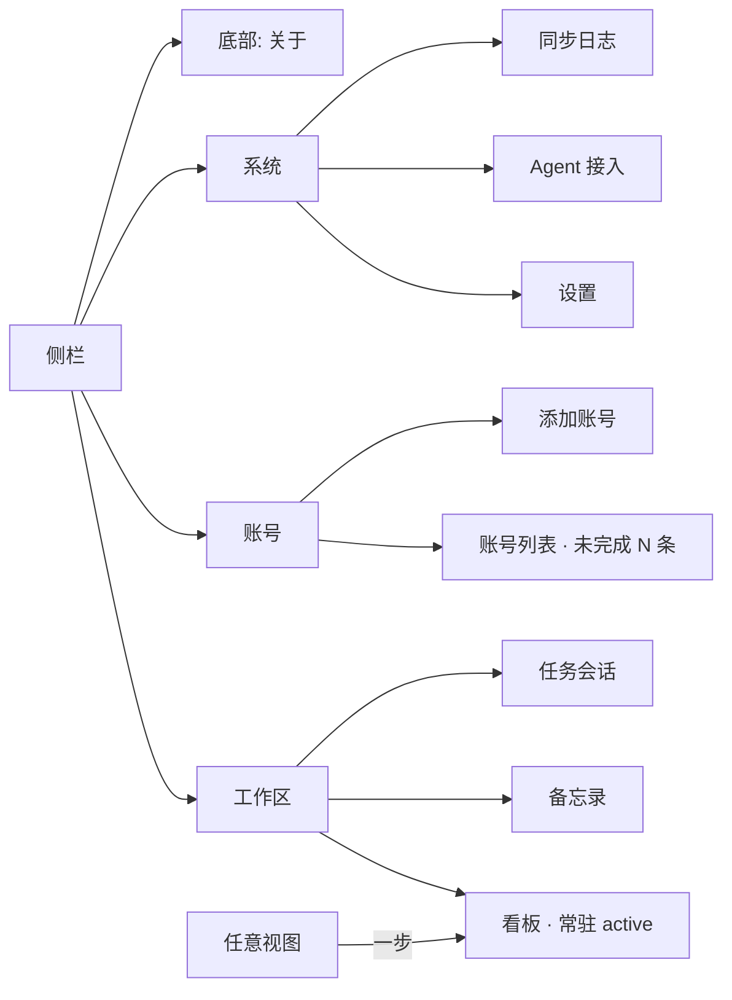

# 界面设计方案 · 既美观又易用 · UI 审查提案

> **一句话**：核查结论是「**视觉系统健康、信息架构与交互习惯欠账**」——v0.8.9 已把令牌、明暗双主题、对比度与焦点环做扎实，本方案不重做视觉，只解决「不好用」；交付一份带验收标准的界面设计提案，**本期不改任何应用代码**。
>
> **状态**：🟡 待评审 / 未排期 · **影响面**：`app/src/styles.css`（拟）· `Sidebar.tsx` / `TaskCard.tsx` / `Board.tsx` / `DetailPanel.tsx`（拟）· **零 DB schema / 零新依赖 / 零 Tauri command 变更** · **对应 issue**：[#557](https://github.com/ShawnLiuSZ/task-dashboard/issues/557)
>
> **配套原型**：可交互 HTML 原型与浅深对照截图位于工作区 `.workbuddy/ui-review/`（`taskboard-ui-proposal.html` 等），属本地审查产物，**未入库**；本文件是可随仓库流转的设计事实源。

---

## 一、背景 / 动机

用户诉求：「核查用户界面，要求既美观又易用，创建符合用户习惯的界面设计方案」。

落到设计上要先回答一个问题：**当前界面的问题到底是「审美不够好」，还是「用户不知道怎么用」？** 核查结论是后者居多。项目在 [`v0.8.9-ui-visual-refresh.md`](./v0.8.9-ui-visual-refresh.md) 已完成一轮令牌化重构（非令牌硬编码色值 235 → 0、圆角 12 种 → 4 档、深色块 27 → 125、`color-mix()` 3 → 0、三段式焦点环、全量对比度达标），视觉系统是健康的；但同一份文档的「遗留风险」L1 / L3 与交互层欠账一直未排期。

因此本方案的目标是：**在完全不破坏既有可访问性基线的前提下，让看板符合桌面看板类工具（Trello / Jira / Linear / GitHub Projects）的通用操作习惯，并把信息层级还给任务标题。**

---

## 二、核查方法

不凭观感下结论，三步交叉验证：

1. **读源码**：`App.tsx` / `Board.tsx` / `TaskCard.tsx` / `Sidebar.tsx` / `DetailPanel.tsx` / `styles.css` 全量核对 DOM 与交互绑定。
2. **渲染真实界面**：复刻真实 DOM，引用**真实** `app/src/styles.css`，用 Chrome 无头渲染浅 / 深两套截图；给 `<html>` 加 `data-theme="dark"` 复现深色。
3. **量化实测**：`--dump-dom` + 注入脚本读 `getComputedStyle` / `getBoundingClientRect`，把「看着别扭」变成数字。

### 2.1 量化基线（1440 宽 / 浅色 / 四态看板）

| 指标 | 实测值 | 说明 |
|---|---|---|
| `.card-title` | **12px / 400** | 任务标题 |
| `.repo` / `.num` | **13px / 400** | 仓库名与编号，**比标题还大** |
| 卡片结构 / 高度 | **6 行 / 154–172px** | 创建人 == 分配人、创建于 + 更新日期重复 |
| `.board-wrap` + `.board` padding | **16px + 16px = 32px** | 两层叠加 |
| 卡片距主区左缘 | **40px** | 工具条内容仅 16px ⇒ 错开 24px |
| 第 4 列右缘 | **1548px > 1440px** | 列固定 320px ⇒ 四态视图被裁 108px，须横向滚动 |
| 顶栏 + 工具条 | **40px + 44px** | 同底色两条白条，仅 0.5px 线分隔 |
| 单卡彩色元素 | **最多 6 个** | 仓库 chip / @我 / 新评论 / PR / 会话 / 认领 / 待确认 / 红左边框 |

> ⚠️ 文档一律用「选择器名 + 令牌名」定位，不写行号 —— 并发改动会让行号立刻过期。

---

## 三、审查结论

| 级别 | 问题 | 依据 | 后果 |
|---|---|---|---|
| 🔴 P0 | 四态看板**不能拖卡换列** | 全前端 `draggable` / `onDrag*` 零命中；改状态只能「点卡片 → 详情面板 → 状态 seg → 确认框」 | 违背看板类工具第一心智模型，高频操作被埋 4 层 |
| 🔴 P0 | 侧栏**没有「看板」入口** | `Sidebar.tsx` 的 `NavKey` 含 `'board'`，渲染分支却只有 notes / sessions / 账号 / 系统 / 关于 | 默认视图在导航里无选中态；进设置后没有明确的「回看板」路径（v0.8.9 遗留 L3 仍在） |
| 🔴 P0 | **零全局快捷键** | 只有 `useEscLayer` 的 Esc 分层与备忘录 ⌘Enter；无搜索聚焦 / 刷新 / 卡片导航 | 桌面效率工具完全依赖鼠标 |
| 🔴 P0 | **点卡片 ≠ 看详情** | 卡片本体打开**不含正文**的精简 modal（#526），完整详情在右下角 12px 灰色外开图标（#531） | 「点卡片看内容」的预期落空，真正入口发现成本极高 |
| 🟠 P1 | **标题不是第一视觉落点** | 12px/400 vs 13px/400，零字重差 | 扫视先读到「哪个仓库 #几号」，而非「这件事是什么」 |
| 🟠 P1 | 信息过载且有重复 | 6 行 / 154–172px；个人仓库里创建人常等于分配人 | 一屏仅 4 张卡，密度高而信息增量低 |
| 🟠 P1 | 彩色预算超标 | 单卡最多 6 个彩色元素 | 信号无主次，深色主题下更跳 |
| 🟠 P1 | 四列在 1440 宽下看不全 | 第 4 列右缘 1548px | 最常用的四态视图必须横向滚动 |
| 🟠 P1 | 留白不对齐 | 两层 padding 叠加，卡片 40px vs 工具条 16px | 工具条与看板左缘错开 |
| ⚪ P2 | 双白条 + ARIA 语义 | 40 + 44px 同底；`role="list"` 内直接放 `role="button"`，卡内又嵌 `button` / `a` | 区域层级不清；读屏播报与焦点顺序混乱（v0.8.9 遗留 L1） |

### 3.1 明确保留的部分

✅ 令牌驱动的明暗双主题、全部达标的对比度（正文 ≥ 4.5:1、图形 ≥ 3:1）、三段式焦点环、预计算 hex 混色、4 档圆角 / 4 档阴影 / 语义 `z-index`、四态「圆点 + 底色 + 文字」三重冗余、根字号 `calc` 接线、形状通道悬停反馈。**本方案不推翻其中任何一条。**

---

## 四、设计 / 方案

### 4.1 八条原则（编号）

1. **标题优先（Title-first）**：卡片第一落点是任务标题，14px / 600；仓库与编号降为 11px 次级信息。
2. **彩色预算 ≤ 2 / 卡**：颜色只给需立刻决策的信号（@我 / 无人认领 / 待确认关闭）；仓库身份改中性文字，PR / 会话 / 评论去底色只留文字。
3. **渐进披露**：卡片默认 3 行，次要信息收进详情抽屉；创建人与分配人相同只显示一次，绝对时间改相对时间。
4. **导航可定位**：侧栏「工作区 / 账号 / 系统」三段带标题，「看板」为首个主项且常驻选中态。
5. **直接操作**：拖卡换列 + 卡片「⋯」菜单改状态；点卡片 = 打开完整详情，不再分「精简 modal / 完整窗」两套心智。
6. **键盘优先**：⌘K 搜索、1–4 改状态、Esc 关闭、R 同步，快捷键在界面上可见。
7. **单一栅格**：工具条与看板共用 16px 内容边距；列宽弹性化，四态视图在 1440 宽下一屏看全。
8. **不破坏既有可访问性基线**：不新增颜色令牌（沿用 `--info` / `--warning` / `--amber` / `--success` 等既有配对），焦点环沿用三段式，点击目标 ≥ 24×24。

### 4.2 导航信息架构

> 与现状唯一的结构差别是**新增「看板」项并给三段加标题**。各设置类面板内部已有的 `onClose → setNav('board')` 保留，但不再作为唯一的返回路径。

### 4.3 组件规格

| 元素 | 现状 | 提案 | 依据 |
|---|---|---|---|
| 卡片标题 | 12px / 400 / `--text` | **14px / 600** / `--text` / 行高 1.45 / 2 行截断 | 与 11px meta 形成 1.27× 字号 + 200 字重差 |
| 仓库 #编号 | 13px 淡彩 chip | 11px `--text-3` 纯文字 + 右侧相对时间 | 身份信息不需要色彩；相对时间可读更快 |
| 卡片结构 | 6 行 / 154–172px | 3 行 / **实测 113px**（约 −34%） | 760px 高看板区同屏 4 → 5 张；信息未减少，只是折叠进详情 |
| 信号徽章 | 最多 6 个彩色元素 | ≤ 1 个彩色 + 1 个可选左边框 | 遵循 v0.8.9 的「彩色预算」口径 |
| PR / 评论 / 会话 | 各自带底色胶囊 | 纯文字链接，hover 走下划线（形状通道） | 沿用 `.cmt-link:hover` 已验证做法，不破 AA |
| 卡片「⋯」操作 | 外开图标常驻 | 默认隐藏，hover / `focus-within` / 选中时显现 | 减少常驻噪音；键盘仍可达，`prefers-reduced-motion` 下去过渡 |
| 列宽 | 固定 320px | `flex: 1 1 0`，min 240px / max 360px | 1440 视口下 4 列各约 280–295px，一屏看全 |
| 容器边距 | 32px（两层叠加） | 统一 16px 内容栅格：容器 8px + 列内 8px | 搜索框左缘与首列卡片左缘误差 **0px** |
| 工具条 | `--surface`，与顶栏同色 | `--surface-2`，含搜索图标 + ⌘K 提示 + 结果数 | 区域层级靠底色区分，不靠分割线 |
| 同步状态 | 淡文字 + 实心主按钮两个割裂元素 | 状态胶囊（绿点 + 已同步时间）+ 主按钮 | 信息与动作邻接，语义自明 |
| 侧栏分组 | 仅「账号」有标题 | 工作区 / 账号 / 系统三段标题 + 看板常驻 active | 当前位置永远可见 |
| 详情入口 | 精简 modal + 12px 外开图标 | 点卡片 = 右侧 420px 完整详情抽屉 | 单一心智模型；抽屉比 modal 更适合对照看板 |
| 空列 | 一行 hint 文字 | 图标 + 文案 + 「从其他列拖一张过来」 | 空态给下一步动作 |

> ⚠️ 规格中的数值以 `styles.css` 工作树为唯一事实源；本表是**提案目标值**，落地后以实测复核为准。

### 4.4 交互矩阵

| 动作 | 触发 | 反馈 | 可访问性 |
|---|---|---|---|
| 改状态 | 拖卡片到目标列 / 「⋯」菜单 / 抽屉内状态段 | 列高亮 → 卡片移动 → 计数更新 → toast「#531 已移至 处理中」 | 三条路径等价；非拖拽路径完整可用 |
| 看详情 | 点击卡片 / 选中后 Enter | 右侧抽屉滑入，含正文、状态、时间线 | 焦点移入抽屉，Esc 返回原卡片 |
| 搜索 | ⌘K（⌃K）/ 点击输入框 | 聚焦并全选；输入实时过滤，结果数同步 | 快捷键在界面可见（kbd 提示） |
| 快速改状态 | 选中卡片后按 1 / 2 / 3 / 4 | 卡片移到对应列 + toast | 与拖拽结果一致，不引入第二套语义 |
| 同步 | 主按钮 / R | 状态胶囊转「同步中…」→「已同步 时间」 | 忙态用形状通道 + `aria-busy`，不只靠颜色 |
| 回看板 | 侧栏「看板」 | 导航项 active，主区切回看板 | `aria-current="page"` |

**三条改状态路径必须汇聚到同一个本地写命令**（`set_task_status` 类既有能力），结果完全一致；不得出现「拖拽写 A、菜单写 B」的第二套语义。

---

## 五、接口 / 行为变更（拟，尚未落地）

| 层面 | 拟变更 |
|---|---|
| `Sidebar.tsx` | 新增「看板」`NavItem` + 三段分组标题 + `aria-current="page"`；`NavKey` 的 `'board'` 终于有对应渲染分支 |
| `TaskCard.tsx` | 卡片 markup 由 6 行收敛为 3 行；标题放大加粗；重复字段合并；新增「⋯」状态菜单；`draggable` + `role="listitem"` 语义修正 |
| `Board.tsx` | `.column-body` 接 `dragover` / `drop`；列宽弹性化；空态补引导；`role="list"` 内子元素改 `role="listitem"` 包裹 |
| `App.tsx` | 全局快捷键（与 `useEscLayer` 分层共存， Esc 仍归分层管理）；点卡片统一打开完整详情抽屉 |
| `styles.css` | 去掉 `.board-wrap` 左右 padding；`.toolbar` 底色改 `--surface-2`；新增 `.p-*` 组件类（**只引用既有令牌**） |
| MCP / Tauri command | **零变更**；写操作仍走既有本地工具 |

> ⚠️ B4「详情统一」涉及 #526 / #527 已裁定的「modal 精简 / 独立窗完整」双形态决策，属**行为变更**，需主理人拍板后单独排期，不与 B1/B2 混做。

---

## 六、数据 / Schema 变更

**无**。不新增表、不改 `tasks` 列、不 bump `SCHEMA_VERSION`、`check-mcp-columns.py` 不受影响。所有状态写操作仍落本地 SQLite，GitHub 同步方向保持只读（用户确认的显式写回除外）。

---

## 七、改版优先级

| 批次 | 状态 | 内容 | 影响面 | 视觉风险 |
|---|---|---|---|---|
| B1 · 导航归位 | 🟢 建议先做 | 侧栏加「看板」项 + 三段分组标题 + `aria-current` | `Sidebar.tsx` + 少量 CSS | 无（新增一项） |
| B2 · 卡片重构 | 🟢 建议先做 | 标题放大加粗、3 行结构、重复字段合并、彩色预算 ≤ 2 | `TaskCard.tsx` + CSS + 相关单测 | 中（信息取舍需确认） |
| B3 · 直接操作 | 🟡 需评审 | 拖卡换列 + 「⋯」菜单 + 键盘 1–4 | 新增交互层；写操作仍走既有本地命令 | 低 |
| B4 · 详情统一 | 🟡 需评审 | 点卡片开完整详情抽屉，统一 modal / 独立窗两套心智 | 涉及 #526 / #527 既有决策 | 中 |
| B5 · 栅格对齐 | 🟢 低风险 | 去掉叠加 padding、列宽弹性化、工具条换 `--surface-2` | 纯 CSS | 低 |
| B6 · 快捷键 | 🟢 低风险 | ⌘K / R / Esc / 1–4 + 界面提示 | 新增 window 级监听，需与 `useEscLayer` 共存 | 无 |

建议顺序：**B1 + B2 + B5 一批**（纯前端、视觉收益最大、风险最低）→ 评审后再上 B3 / B4 / B6。

---

## 八、测试 / 验收

### 8.1 验收标准（编号）

1. 1440×900 窗口下四态看板 4 列全部完整可见，无横向滚动条；工具条输入区与首列卡片左缘对齐（误差 ≤ 1px）。
2. 卡片标题计算样式为 14px / 600，且不小于卡片内任何其他文本；卡片高度 ≤ 120px（2 行标题，原型实测 113px）。
3. 单卡同时出现的彩色元素 ≤ 2；所有文字 / 底色组合沿用既有令牌，浅深两套主题实测对比度均 ≥ 4.5:1。
4. 拖卡、菜单改状态、键盘 1–4 三条路径产生完全相同的结果（含计数与 toast）。
5. 侧栏在任意视图下都有一个且仅一个 active 项；从设置页点「看板」可一步返回。
6. ⌘K 聚焦搜索、Esc 关闭抽屉并把焦点还给原卡片；全链路可纯键盘完成「搜索 → 选中 → 改状态 → 看详情」。
7. 焦点环沿用三段式且在 `overflow-y: auto` 的列容器内不被裁；点击目标 ≥ 24×24。
8. 落地后 `npx tsc --noEmit` / `npm test` / `npm run lint` / `npm run i18n:check` / `styles.test.ts` 全绿；新增的纯 CSS 判据需做「注入缺陷变红 → 还原全绿」反向验证（见 [`methodology-assertion-strength-audit.md`](./methodology-assertion-strength-audit.md)）。

### 8.2 原型自检（已跑，全绿）

可交互原型在 Chrome 无头下执行 `?selftest=1`，结果：

| 项 | 实测 |
|---|---|
| 渲染列 / 卡片 / 可拖卡片 | 4 / 7 / 7 |
| 标题计算样式 | 14px / 600 |
| 侧栏「看板」active | ✅ |
| 卡片高度 | 113px |
| 四列在视口内（`boardFitsViewport`） | ✅ |
| 工具条内容 ↔ 卡片左缘误差 | **0px** |
| 移动 `#531` 到「处理中」后该列卡片数 | 3 |
| 搜索 `Helix` 后剩余卡片 | 1 |

> 原型验证的是**交互与布局可行性**，不是应用代码已落地。落地时上述数值需在真实 `styles.css` 上重新实测。

---

## 九、明确不改的边界

- **不新增任何 `--*-bg` 颜色令牌** —— 项目规范要求新增背景令牌必须同时给出 `--text` / `--text-2` / `--text-3` / `--accent` 四列字色矩阵，成本高于收益；本方案全部复用既有「语义色 + 配对语义底」。
- 不改 `:root` / `[data-theme='dark']` 的既有值与变量名，不改 `theme.ts` / `fontPrefs.ts`，不引入 `color-mix()` / `oklch()`（`build.target` 为 chrome105 / safari13，声明会整条失效）。
- 不引入新依赖、不改 SQLite schema、不改 GitHub 同步方向。
- 原型里的拖拽、抽屉、快捷键均为**前端交互演示**；落地时写操作必须接到既有本地 MCP / Tauri 命令，不得直接写 GitHub。

---

## 十、相关链接

- [GitHub issue #557](https://github.com/ShawnLiuSZ/task-dashboard/issues/557) —— 本方案的任务追踪；分支 / KB 文档 / commit 均引 `#557`
- [`v0.8.9-ui-visual-refresh.md`](./v0.8.9-ui-visual-refresh.md) —— 上一轮视觉重构；本方案的「保留基线」与遗留风险 L1 / L3 出处
- [`issue-527-task-detail-window.md`](./issue-527-task-detail-window.md) —— modal / 独立窗双形态的既有决策（B4 需重新裁定）
- [`issue-516-sidebar-open-count-and-account-name.md`](./issue-516-sidebar-open-count-and-account-name.md) —— 侧栏账号分组与计数口径
- [`methodology-assertion-strength-audit.md`](./methodology-assertion-strength-audit.md) —— 断言强度审计五条纪律，落地时新增 CSS 断言须遵循
- [`roadmap.md`](./roadmap.md) —— 下 3 版意图；本方案 B1/B2 可作为候选输入
- [`CHANGELOG.md`](./CHANGELOG.md) —— ⚠️ 本方案为**待评审提案、未发布、未落地**，暂不追加版本条目；落地发版时按 `AGENTS.md` §5.3 补链接
- 仓库规范：[`AGENTS.md`](../AGENTS.md) §2 硬约束 · [`AGENTS.md`](../AGENTS.md) §5 知识库文档 · [`CONTRIBUTING.md`](../CONTRIBUTING.md) 文档索引
- 本地审查产物（**未入库**）：`.workbuddy/ui-review/taskboard-ui-proposal.html`、`current-light.png` / `current-dark.png` / `proposal-light.png` / `proposal-dark.png`
